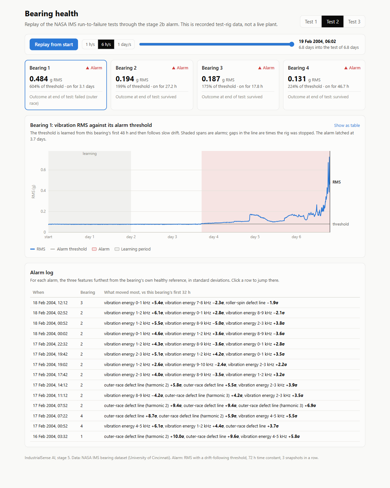

# IndustrialSense AI

[](https://github.com/ankitsingathia/industrialsense-ai/actions/workflows/tests.yml)

Bearing and motor fault early warning from vibration and motor current, aimed at a microcontroller.

This started as a proposal I made at work: use the data a plant already records to catch equipment faults before they trip a line. Plant data stays inside the plant, so this repo builds and tests the method on public bearing datasets. Every number below comes from a script in this repo.

**Status (18 Nov 2026):** all five stages are done:
1. diagnosis on CWRU
2. early warning on the NASA IMS run-to-failure tests
3. vibration vs motor current on Paderborn
4. an int8 CNN in C, sized for a Cortex-M4
5. a dashboard that replays the IMS tests

The open items are in [Roadmap](#roadmap) and [Limits](#limits).

| Stage | Headline result |
|---|---|
| 1 | Envelope features halve the leave-one-load-out errors on CWRU (macro-F1 0.949 → 0.974). The RMS alarm false-alarms on 100% of healthy windows at an unseen load. |
| 2 | Early warning on 4 natural failures: the RMS alarm with a held-out threshold gives 74–159 h of warning. Learned detectors don't beat it. |
| 2b | A drift-following threshold cuts false alarms 91% (117 → 10) and still catches all 4 failures (49–120 h of warning). |
| 3 | On unseen Paderborn bearings, scores fall from 0.997 (random split) to at most 0.62. Defect-line features generalise best. Motor current's score doesn't come from bearing physics. |
| 4 | The CNN matches the features on average (0.969–0.986). In int8 C it is bit-exact with the reference: 23.9 KB flash, 8 KB RAM. |
| 5 | The dashboard explains each alarm by the features that moved. It named the right defect for 1 of the 4 failures. |

---

## The problem

The common plant practice is a fixed alarm on overall vibration RMS. Two things go wrong with it:

1. **RMS is a loudness measure.** It says something is shaking, not what is failing, so the maintenance team still has to diagnose by hand.
2. **The threshold is set for one operating condition.** Load changes the healthy vibration level, so a threshold that is quiet at one load can alarm constantly at another.

Stage 1 measures both on the CWRU dataset.

## Stage 1 results: CWRU drive-end bearings, 10 classes

40 recordings: healthy plus 9 faults (inner race, outer race and ball, each at 0.007/0.014/0.021 in), at 4 motor loads. They give 4,643 windows of 2,048 samples (0.17 s at 12 kHz), with 50% overlap.

Evaluation is **leave-one-load-out**: train on three loads, test on the fourth, for each load in turn. No recording is on both sides of a split.

### The RMS alarm (healthy mean + 3σ, set on the training loads)

| Test load | Threshold (g) | Healthy windows that alarm | Fault windows caught |
|---|---|---|---|
| 0 hp | 0.064 | **100%** | 100% |
| 1 hp | 0.077 | 0% | 100% |
| 2 hp | 0.077 | 0% | 100% |
| 3 hp | 0.077 | 0% | 100% |

It catches every fault, because CWRU faults are seeded and already well developed. But a threshold learned on 1–3 hp fires on **every** healthy window at 0 hp, where the healthy bearing runs at about 0.073 g. That is the operating-condition problem in one row. It is also why CWRU cannot test *early* warning: that needs run-to-failure data (stage 2).

### Diagnosis (macro-F1 across 10 classes)

| Features | Model | Naive random split | Leave-one-load-out | Worst load |
|---|---|---|---|---|
| Time-domain (RMS, kurtosis, crest factor and 6 more) | Random forest | 0.968 | 0.949 | 0.907 |
| Time-domain | Gradient boosting | 0.969 | 0.943 | 0.909 |
| Envelope spectrum at defect frequencies | Gradient boosting | 0.959 | 0.946 | 0.912 |
| **Time + envelope** | **Gradient boosting** | **0.979** | **0.974** | **0.961** |

Adding envelope-spectrum features cuts the leave-one-load-out error from 5.1% to 2.6%, about half the mistakes. The gain is biggest at the hardest load (0 hp: 0.907 → 0.961).

The naive split scores only slightly higher than leave-one-load-out here (0.979 vs 0.974). CWRU notebooks often report near-perfect accuracy; on this setup the leak is small, and I report it as measured.

Reproduce: `python scripts/run_baselines.py` (writes `results/baselines.json`).

## What the data audit found

**The healthy files are recorded at 48 kHz, not 12 kHz.** They are listed with the 12 kHz data, but each is four times longer for the same 10 seconds. Read at 12 kHz, their strongest low-frequency line sits at 29.98 Hz at every load. Read at 48 kHz, the line follows motor speed to within one FFT bin: 29.91 Hz at 1,796 rpm down to 28.75 Hz at 1,725 rpm. The fixed line was really 120 Hz, twice the 60 Hz mains, which is magnetic vibration from the motor, not shaft speed. The loader decimates these files by 4.

I measured what the bug would have done. Without the fix the F1 scores are within 0.01 of the corrected ones (`results/ablation_no_resample.json`). So it did not inflate accuracy on this split, but it gave the healthy class a spectrum scaled by 4× and four times as many windows. Any frequency-based model, and any transfer to real plant data, would inherit that.

**99.mat also contains 98.mat's channels.** The loader picks the variable whose number matches the file. A test checks this.

## Stage 2 results: early warning on NASA IMS

Three tests in which four Rexnord ZA-2115 bearings on one shaft ran at 2,000 rpm until bearings failed on their own: 9,461 one-second snapshots at 20 kHz (3 more, taken after the rig had stopped, are dropped), one every 10 minutes, across 12 bearings. Four bearings failed (inner race, roller, and outer race twice); the other eight survived.

Each detector sees only one bearing's first 48 monitored hours. It is fitted on the first 32 hours, and its threshold (mean + 3σ) is set on the next 16 hours, which it has not seen. An alarm needs 3 snapshots in a row over the threshold (30 minutes). Every detector gets exactly this rule.

- **RMS alarm:** overall vibration level, the plant baseline.
- **Isolation Forest:** 33 features per snapshot: 9 time-domain, 10 one-kHz band energies, and 14 envelope features at this bearing's defect frequencies.
- **Autoencoder:** a small PyTorch MLP (33 → 16 → 4 → 16 → 33) on the same features. The score is reconstruction error.

**Lead time.** Hours from the moment the alarm comes on *and stays on* (on for at least 90% of the remaining snapshots) to the end of the test:

| Failure | RMS alarm | Isolation Forest | Autoencoder |
|---|---|---|---|
| Test 1, bearing 3, inner race | 86 h | 79 h | 82 h |
| Test 1, bearing 4, roller | 159 h | never stays on | 156 h |
| Test 2, bearing 1, outer race | 74.5 h | 74.5 h | 74.5 h |
| Test 3, bearing 3, outer race | 83 h | 59 h | 352 h* |

**False alarms on the eight bearings that survived:**

| | RMS alarm | Isolation Forest | Autoencoder |
|---|---|---|---|
| Alarms | 117 | 13 | 202 |
| Bearing-days watched | 137.3 | 145.0 | 103.8 |
| Per bearing per week | 6.0 | 0.6 | 13.6 |

\* The autoencoder's 352 h in test 3 is not a real early catch. Over the same weeks it was in alarm 87% of the time on a bearing that survived.

**What this shows:**

- **The RMS alarm is a hard baseline to beat on this data.** Once its threshold is set on held-out data and it needs 30 minutes of persistence, it gave 74–159 h of warning on all four failures. Neither learned detector beat it on lead time.
- **RMS's false alarms come almost all from one bearing.** 116 of its 117 are on test 3, bearing 4. Over six weeks, the level on that bearing, which survived the test, crept up about 5–8%, and a threshold learned in the first two days cannot follow slow drift.
- **Isolation Forest cut false alarms by 89% (117 → 13), at a price.** It never held an alarm on the roller failure, and it gave 24 h less warning on test 3.
- **The autoencoder was the least stable of the three.** With a few hundred training snapshots, four bottleneck units still fit the healthy period too closely.
- **The setup moved the results more than the model did.** The sweep in `results/early_warning.json` shows it:
  - With a 24 h reference, every detector alarms on test 1 right after its six-day stop: 657 h of "warning" that is really the restart.
  - With a 96 h reference, Isolation Forest raises 263 false alarms against RMS's 129.
  - Persistence alone cuts RMS false alarms from 255 to 117 to 74 (1, 3 and 6 snapshots), at a cost of 4–42 h of lead time.

### Stage 2b: a threshold that follows slow drift

Nearly all of RMS's false alarms come from slow drift, so the next step was to let the threshold follow it. The healthy mean and spread keep learning after the reference period, as an exponentially weighted average with a 72-hour time constant. The time constant was fixed before the run. The threshold learns only from snapshots that are under it, so an alarm already raised does not teach itself to go quiet.

| | Fixed RMS threshold | Drift-following RMS | RMS and Isolation Forest must agree |
|---|---|---|---|
| Failures caught (alarm stays on) | 4 of 4 | **4 of 4** | 3 of 4 |
| Lead time | 74–159 h | 49–120 h | 59–77 h |
| False alarms on surviving bearings | 117 | **10** | 7 |

The drift-following threshold cuts false alarms by 91% and still catches all four failures, at a cost of 24–39 h of warning on three of them. Test 2 is unchanged at 74.5 h. The time constant sets the trade-off:

- 24 h gives 6 false alarms, but only 12 h of warning on test 1's inner race.
- 168 h gives 15 false alarms and 59–148 h of warning.

A fault that grows more slowly than the time constant would be absorbed. That is the limit of this method, and it is why the time constant has to come from how fast real faults grow on the machine.

**How the false alarms are counted.** Every alarm on a surviving bearing counts as false, but only until the failing bearing's alarm latches, by the same detector. After that point it isn't false: all four bearings share the shaft. In test 2 the BPFO envelope line grew 8.8× on the failed bearing, and 1.6–5.1× on its three healthy neighbours.

Reproduce: `python scripts/ims_features.py`, then `python scripts/run_early_warning.py`.

### What the IMS audit found

- **The archive does not match its readme on test 3.** `3rd_test.rar` unpacks to a folder named `4th_test`, with 6,324 files running to 18 April 2004. The readme lists 4,448 files ending on 4 April. The extra two weeks hold the failure: all four RMS levels are flat until the last few days of the full record. A pipeline that trusted the readme's end date would have watched test 3 and seen nothing fail.
- **The last snapshots of tests 2 and 3 were taken after the rig stopped.** Every channel reads about 0.001 g (2 snapshots in test 2, 1 in test 3). They are dropped, so lead time runs to the last snapshot with the machine running. The dashboard found this: its cards showed 0.001 g at the end of test 2.
- **Test 1 stops for six days after its first day.** The 148-hour gap follows the first 24 hours. A reference period that ends before the stop has never seen the machine restart. False alarms are counted per hour watched, not calendar time.
- **The bearing geometry is not in the readme.** The defect frequencies come from the dimensions in its reference paper (Qiu et al., 2006). A test checks them against the published values: BPFO 236.4 Hz, BPFI 296.9 Hz.

## Stage 3 results: vibration vs motor current, on bearings the model has never seen

Most motors in a plant have no vibration sensor, but their current is already measured at the drive. So the question is whether bearing faults can be caught from current alone.

The Paderborn data records vibration and two motor phase currents together, at 64 kHz. The subset here is 15 bearings: 5 healthy, 5 with outer-ring damage and 5 with inner-ring damage. All the damage came from accelerated lifetime tests, not machining. That gives 1,200 four-second recordings across 4 operating conditions, cut into 18,000 windows of 0.26 s.

Each fold tests on one healthy, one outer and one inner bearing and trains on the other twelve. No physical bearing appears on both sides. Macro-F1 across the 3 classes, where chance is 0.33:

| Features | Model | Naive random split | Unseen bearings (window) | Unseen bearings (recording, 15-window vote) |
|---|---|---|---|---|
| Vibration, time-domain (9) | Gradient boosting | 0.927 | 0.419 | 0.406 |
| Vibration, all (23) | Gradient boosting | 0.961 | 0.468 | 0.461 |
| **Vibration, defect lines only (12)** | **Logistic regression** | 0.689 | **0.615** | **0.663** |
| Vibration, defect lines only (12) | Gradient boosting | 0.715 | 0.584 | 0.624 |
| Current, all (32) | Gradient boosting | 0.949 | 0.592 | 0.617 |
| Current, defect sidebands only (16) | Gradient boosting | 0.461 | 0.381 | 0.410 |
| Vibration + current (55) | Gradient boosting | **0.997** | 0.563 | 0.571 |
| Vibration + current (55) | Logistic regression | 0.928 | 0.605 | 0.615 |

All 14 combinations tried are in `results/paderborn.json`, including the ones not shown here.

**What this shows:**

- **The random split is almost meaningless here.** The richest model scores 0.997 on random windows and 0.563 on bearings it has never seen. With 5 bearings per class, a flexible model learns each bearing's individual signature, and a random split rewards that. This is the same leak as stage 1, much larger.
- **Physics features generalise better than general statistics.** The 12 envelope defect-line features beat all 23 vibration features on unseen bearings (0.615 vs 0.468), with a simpler model. The time-domain statistics mostly measure how loud a particular bearing is.
- **Current alone reached 0.59, but not for the reason theory predicts.** Motor-current analysis says a bearing defect shows up as sidebands at supply frequency ± defect frequency. On their own, those sidebands score at chance (0.33–0.38). Current's score comes from broadband and harmonic content, which could just as well be a signature of the test setup. I wouldn't claim it detects bearing damage.
- **Adding current to vibration did not help reliably:** 0.563 to 0.605, depending on the model.

**Answer to the question:** on this data, no. Neither sensor alone nor the two together identify damage on an unseen bearing well enough to act on; the best is 0.66 per recording. The plant would need more bearings per fault class before trusting a classifier. Stage 2's approach, learning each machine's own healthy baseline, avoids the problem because it never has to generalise across bearings.

**Audit note:** the motor has 4 pole pairs. The current's fundamental sits at exactly 4× shaft speed (100.0 Hz at 1,500 rpm, 60.0 Hz at 900 rpm). The current features are built around this, so a test checks it on the raw files.

Reproduce: `python scripts/paderborn_features.py`, then `python scripts/run_paderborn.py`. The 15 archives (2.5 GB, 13 GB unpacked) come from the [KAt-DataCenter](https://groups.uni-paderborn.de/kat/BearingDataCenter/) and are unpacked under `data/raw/paderborn/`.

## Stage 4 results: a CNN on raw vibration, then the same network in int8 C

### 4a. 1D CNN vs the stage 1 features

The CNN is a small WDCNN-style network. It takes the raw 2,048-sample window, starts with one wide strided kernel (64 taps, stride 8) acting as a learned filter bank, then has three small convolutions. That's 22,170 parameters in total. It uses the same windows and leave-one-load-out folds as stage 1, and was trained with 3 seeds:

| | Gradient boosting, time + envelope features | 1D CNN, raw window |
|---|---|---|
| Leave-one-load-out macro-F1 | 0.974 | 0.969–0.986 (3 seeds) |
| Hardest load (0 hp) | **0.961** | 0.930–0.948 |
| Input | 23 hand-built features | 2,048 raw samples |

The CNN matches the hand-built features on average. It is consistently worse at 0 hp, the load furthest from the other three. The CNN's reason to exist is the edge: one fixed chain of integer convolutions, with no FFT, filter design or feature code to port to the microcontroller.

### 4b. ONNX Runtime, fp32 vs int8

Static int8 quantisation in ONNX Runtime, per-channel weights, calibrated on 256 windows from the training loads only:

| Per fold, mean of 4 | fp32 | int8 |
|---|---|---|
| Macro-F1 | 0.9865 | 0.9859 |
| Model file | 87.8 KB | **36.0 KB** (−59%) |
| Latency, one window, 1 thread, i5-12450H | 0.059 ms | **0.032 ms** (1.9× faster) |

### 4c. The int8 network in C, sized for a Cortex-M4

A microcontroller has no ONNX Runtime, so the network is quantised by hand:
- batch norm folded into the convolutions
- int8 weights per channel, int8 activations per layer
- int32 accumulators, requantised with a float multiplier

The quantisation is written twice, once in NumPy (`src/isense/int8.py`) and once in C (`firmware/wdcnn.c`). The C kernel uses no heap.

| | Result |
|---|---|
| C kernel vs NumPy reference | **bit-identical logits** on every held-out window, all 4 folds |
| Macro-F1, C int8 vs fp32 | 0.9865 vs 0.9865 |
| Flash, kernel + weights (Cortex-M4, `-Os`) | **23.9 KB** |
| Static RAM (two ping-pong activation buffers) | 8.0 KB, plus 320 B of stack |
| Work per window | 1.14 M multiply-accumulates |

The flash and RAM numbers come from `arm-none-eabi-gcc` 15.2 and its stack-usage report. They fit an STM32F4-class part (512 KB+ flash, 128 KB+ RAM) with room to spare. **This has not been run on a board, and the latency on the M4 is not measured.** The test `tests/test_firmware.py` builds the C kernel and checks the bit-exact match on every CI run.

Reproduce: `python scripts/run_cnn.py`, then `run_edge.py`, then `run_firmware.py` (needs `gcc` and `arm-none-eabi-gcc` on PATH).

## Stage 5: dashboard



A FastAPI backend and a React frontend replay the three IMS tests through the stage 2b alarm. The page states that it is recorded test-rig data, not a live plant. It shows:
- each bearing's status at the replay time, with its RMS as a share of the threshold and how long the alarm has been on
- RMS against the drift-following threshold, with alarm spans, the learning period and gaps where the rig was stopped (hover for values; a table view is one click away)
- an alarm log: for each alarm, the three features that had moved furthest from that bearing's own healthy reference, in standard deviations

**How the alarm explanations held up.** On test 2 the alarm that latched on the failing bearing is explained by the outer-race defect line (+10σ and +9.6σ on its second and first harmonics), and that bearing failed on its outer race. On the other three failures the top features are broadband energy (1–6 kHz), not the matching defect line. So the explanation names the right defect on 1 of 4 failures. It says *what moved*, not *what failed*.

Building it also surfaced a data problem. The cards showed 0.001 g at the end of test 2, because the last snapshots were recorded after the rig had stopped. Those snapshots are now dropped everywhere, and the stage 2 numbers above include that fix.

Run it:

```bash
pip install fastapi uvicorn
cd dashboard/web && npm install && npm run build && cd ../..
python -m uvicorn api:app --app-dir dashboard --port 8765   # then open http://localhost:8765
```

The replay data (`dashboard/data`, 0.7 MB) is committed, so the dashboard runs without the 6 GB dataset. `scripts/build_dashboard_data.py` regenerates it.

## How the envelope features work

A local defect produces a short impact each time a ball passes it. The impact rings a structural resonance in the kHz range, so the defect rate appears as amplitude modulation of that resonance, not as a clear line in the raw spectrum. The pipeline:

1. band-pass 2–5 kHz
2. Hilbert envelope
3. FFT of the envelope
4. read the energy at the first three harmonics of BPFI, BPFO, BSF and FTF for the measured shaft speed (6205-2RS geometry)

Each value is taken relative to total envelope energy, so the feature does not re-measure loudness. A test checks that scaling the signal by 10× leaves the features unchanged.

On a synthetic outer-race signal (3.5 kHz bursts at BPFO plus noise), the BPFO line stands **133×** above its neighbouring frequencies in the envelope spectrum, against **8×** in the raw spectrum (`tests/test_dsp_and_data.py`).

## Run it

```bash
pip install -r requirements.txt
python -c "import sys; sys.path.insert(0,'src'); from isense import cwru; from pathlib import Path; cwru.download(Path('data/raw/cwru'))"   # 140 MB
python -m pytest -q
python scripts/run_baselines.py
```

Stage 4 needs `pip install torch onnx onnxruntime`.

Stage 2 needs the IMS archive (1.1 GB, about 6 GB unpacked) from the [NASA prognostics data repository](https://phm-datasets.s3.amazonaws.com/NASA/4.+Bearings.zip), unpacked under `data/raw/ims/`, plus `pip install torch` for the autoencoder.

## Limits

- On CWRU, leave-one-load-out still uses the same seeded bearings at every load, so it tests robustness to load, not to a new bearing. Stage 3 tests unseen bearings, and there the best score is 0.62. Training on one dataset and testing on another is not done yet (stage 3b).
- The envelope band is fixed: 2–5 kHz on CWRU, 2–8 kHz on IMS and Paderborn. Choosing it per machine (the kurtogram) is on the list.
- Seeded EDM faults are not natural wear. Stage 2 uses a bearing that wore out on its own.
- Four failures is a small sample. The stage 2 tables describe these four runs, not a failure rate.
- The int8 kernel's flash and RAM come from the compiler. It has not run on a board, so its latency on a Cortex-M4 is unknown.
- Stage 3 has 5 bearings per class. That is enough to show that a random split misleads, not enough to train a classifier a plant should trust.
- "End of test" stands in for failure time. The rig was stopped when a bearing was judged failed, so lead time is measured to that call, not to a seizure.

## Roadmap

| Stage | What | Status |
|---|---|---|
| 1 | CWRU diagnosis, baselines, data audit | done |
| 2 | Early warning on NASA IMS run-to-failure: autoencoder and Isolation Forest trained on healthy data, lead time and false alarms vs the RMS alarm | done |
| 2b | Threshold that follows slow drift (the source of nearly all RMS false alarms); RMS and Isolation Forest voting together | done |
| 3 | Paderborn: vibration vs motor current vs both, tested on unseen bearings | done |
| 3b | Train on one dataset, test on another (CWRU and Paderborn use different bearings and rigs) | planned |
| 4 | 1D CNN, int8 quantisation, ONNX Runtime latency, int8 C kernel sized for a Cortex-M4 (no physical board) | done |
| 5 | React + FastAPI dashboard: machine health, alarm timeline, which band triggered each alarm | done |
| next | Time the int8 kernel on a real Cortex-M4 board; choose the envelope band per machine (kurtogram); more bearings per class for stage 3 | planned |

Design choices and rejected alternatives are in [DECISIONS.md](DECISIONS.md).
